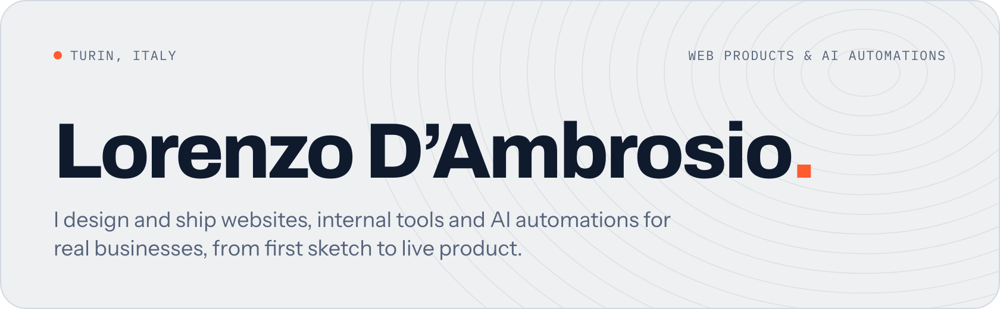
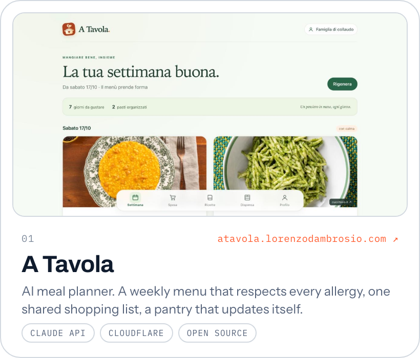
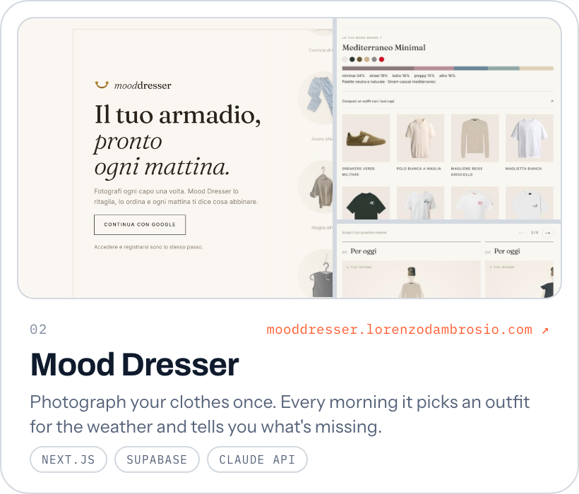
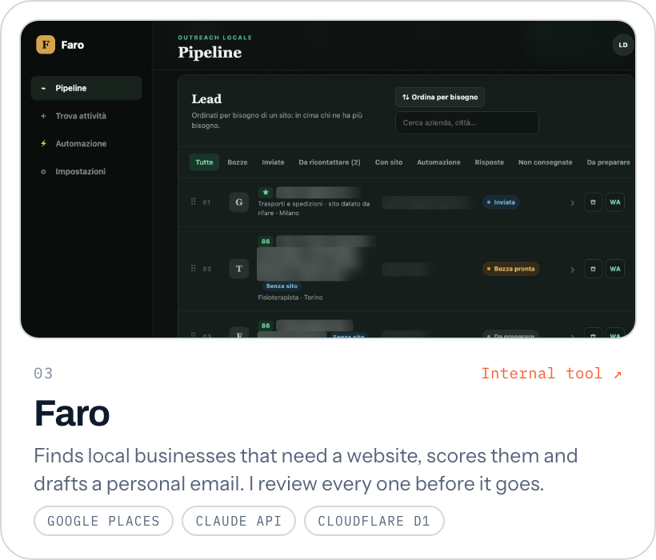
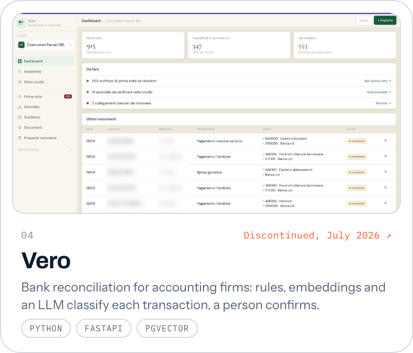
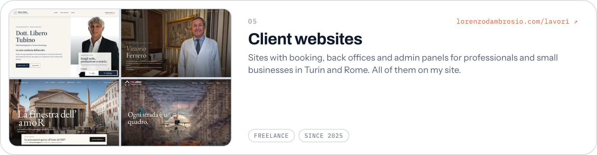

<picture>
  <source media="(prefers-color-scheme: dark)" srcset="assets/banner-dark.png">
  
</picture>

  <samp>
    <a href="https://lorenzodambrosio.com">lorenzodambrosio.com</a> ·
    <a href="https://www.linkedin.com/in/lorenzo-dambrosio">linkedin</a> ·
    <a href="mailto:lorenzo.dambrosio.2004@gmail.com">email</a>
  </samp>

 

  <a href="https://github.com/Lorenzodambrosio22/a-tavola"><picture><source media="(prefers-color-scheme: dark)" srcset="assets/atavola-dark.png"></picture></a>
  <a href="https://trama.lorenzo-dambrosio-2004.workers.dev"><picture><source media="(prefers-color-scheme: dark)" srcset="assets/trama-dark.png"></picture></a>

  <a href="https://github.com/Lorenzodambrosio22/faro"><picture><source media="(prefers-color-scheme: dark)" srcset="assets/faro-dark.png"></picture></a>
  <a href="https://github.com/Lorenzodambrosio22/vero"><picture><source media="(prefers-color-scheme: dark)" srcset="assets/vero-dark.png"></picture></a>

  <a href="https://lorenzodambrosio.com/lavori"><picture><source media="(prefers-color-scheme: dark)" srcset="assets/clients-dark.png"></picture></a>

 

**How I work.** I start from how the people who'll use the product actually work, write the spec, and develop with AI coding agents, with tests on the parts that can't break. Then I stay on after launch.

Computer Engineering at Politecnico di Torino. Client code stays private; I'm happy to walk you through any of it.

<samp>TypeScript · React · Next.js · Cloudflare Workers · Supabase · Python · FastAPI · Claude API</samp>
